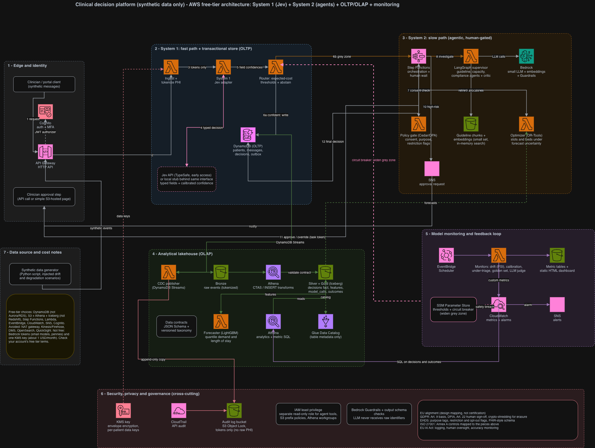

# Dyad

**Fast model + slow agents for clinical decisions on AWS.**

Dyad is a free-tier-friendly AWS reference build for clinical decision support. A fast
System One model makes most decisions in a single pass, an agentic System 2 handles the hard
cases, and a clinician approves anything high-risk. Transactional and analytical data are
separated, every model is monitored, and the design is aligned with EU health-data rules.

> **Research prototype. Not a medical device.** It gives no clinical advice and must never be
> used with real patient data. All data in this repository is synthetic. See
> [DISCLAIMER.md](DISCLAIMER.md).

## The idea

Most automated decisions do not need a slow, expensive reasoning model. Dyad splits the work
the way people do (fast intuition, slow deliberation):

- **System 1 (fast):** a System One model, such as TypeSafe's Jev, returns typed decisions
  with calibrated confidence per field instead of free text.
- **Router:** an expected-cost rule decides which cases are safe to act on and which need
  more thought. Missing an urgent case costs far more than over-escalating one.
- **System 2 (slow):** LangGraph agents on Amazon Bedrock investigate uncertain cases using
  retrieved clinical guidelines, with a critic that challenges the recommendation.
- **Human gate:** a clinician approves urgent cases, overrides, and disagreements.
- **The decision is a table:** every decision lands in an analytical `decisions` table that
  feeds monitoring, retraining and audit.

## Architecture




| Concern | Choice |
|---|---|
| Transactional store | DynamoDB with Streams |
| Analytical store | S3, Iceberg, Glue Data Catalog, Athena (bronze, silver, gold) |
| Orchestration | Step Functions, EventBridge Scheduler |
| Agents and LLMs | LangGraph on Amazon Bedrock |
| Auth and security | Cognito, KMS, IAM, CloudTrail, S3 Object Lock |
| Monitoring | Athena metric queries, CloudWatch, static HTML dashboard |
| Infrastructure | AWS CDK (Python) |

## Design principles

- **Modular monolith.** One repo, one codebase, nine modules. Each module is its own Lambda
  and its own release unit. Modules never import each other. They share only versioned
  contracts and ports from `src/dyad/kernel/`, and import-linter enforces it in CI.
- **Thin handlers, pure domain.** Business logic has no AWS dependencies and is tested with
  fakes. Only adapters touch boto3.
- **Privacy by construction.** Identifiers are tokenized before any model call. Per-patient
  data keys allow crypto-shredding, which reconciles erasure with an immutable audit log.
  Tokenized data is pseudonymised, not anonymous.
- **Safety defaults.** Anything emergent goes to a human. Missing or invalid confidence
  escalates. The circuit breaker can only widen the grey zone, never narrow it.
- **Honest numbers.** Vendor claims about Jev are vendor-reported. Dyad benchmarks Jev against
  a classic model and an LLM on its own synthetic data and reports only those results.

## Repository layout

```
src/dyad/kernel/        shared contracts, ports, tokenization, logging, config (keep small)
src/dyad/modules/       ingest, system1, router, policy, agents, optimizer,
                        forecasting, cdc, monitoring  (module.yaml, handler.py, domain/, adapters/)
infra/                  CDK: platform stacks + one stack per module
contracts/              exported JSON Schema and the versioned taxonomy
sql/                    Athena SQL for bronze, silver, gold and monitoring
tools/                  synthetic data generator, packaging and CI helpers
benchmarks/             Jev vs baseline vs LLM comparison
local/                  Docker Compose for local AWS emulation (Floci)
tests/                  modules, contract, flow, golden, integration
docs/                   architecture, DPIA draft, ISO 27001 mapping, EHDS/GDPR notes, ADRs
.claude/                Claude Code skill and guardrails
```

## Getting started

Prerequisites: Python 3.12, [uv](https://docs.astral.sh/uv/), Node.js (for the CDK CLI),
Docker, and an AWS account for deployment.

```bash
# install dependencies
uv sync --all-groups

# start the local AWS emulator (Floci) and point clients at it
docker compose -f local/docker-compose.yml up -d
set -a; source local/env.local.example; set +a

# checks
uv run ruff check . && uv run ruff format --check .
uv run mypy src
uv run lint-imports
uv run pytest
uv run pytest -m integration        # needs the emulator running

# infrastructure
npx cdk synth
```

Integration tests refuse to run unless `AWS_ENDPOINT_URL` points at the local emulator. The
emulator is a fast feedback loop, not full AWS parity. Athena SQL on Iceberg and Bedrock
calls still need checking against a real account.

## Releasing a single module

Each module is packaged and deployed on its own, so a change to one Lambda does not redeploy
the others.

```bash
make package MODULE=router
npx cdk deploy dyad-router --exclusively
```

CI detects which modules changed. A change to `src/dyad/kernel/` or to a contract affects
every module, so it is called out in the pull request. Contracts are additive within a major
version, and breaking changes become a new version.

## Monitoring

Every model call is logged with its version, confidence, latency and cost. Monitors track
calibration per field, confidence drift, routing mix, agent-versus-clinician agreement and
forecast error. The headline safety metric is the **under-triage rate**: how often the fast
model said routine where a clinician said urgent. Labels arrive late, so metrics are
computed in three tiers (immediate, fast proxy, delayed ground truth), always with
point-in-time joins.

## EU alignment

Dyad is designed to align with, not to certify against:

- **GDPR:** lawful basis for health data, DPIA, human sign-off on urgent cases, erasure by
  crypto-shredding.
- **EHDS:** purpose tags, restriction and opt-out flags, FHIR-style data model. The
  regulation applies in phases from 2027.
- **ISO/IEC 27001:** technical controls mapped to Annex A themes.
- **EU AI Act:** logging, human oversight and accuracy monitoring for a high-risk use case.

See `docs/` for the mappings. None of this is legal advice or a compliance claim.

## Working with Claude Code

This repo includes a Claude Code skill (`.claude/skills/dyad-standards/`) with the code
standards and business rules, plus permission rules and a hook that block Claude from
committing or pushing. Claude works in the working tree. The owner reviews, commits and
opens pull requests.

## Contributing

`main` is protected: changes arrive through pull requests from feature branches. Use
conventional commits scoped to a module, for example `feat(router): add per-field abstention`.

## Status

Work in progress. System 1 runs behind an interface with a local stub, because Jev is in early
access. The multi-agent critic, the forecaster and the automatic circuit breaker are
stretch goals.

## License

To be decided.